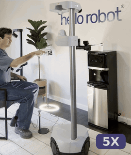
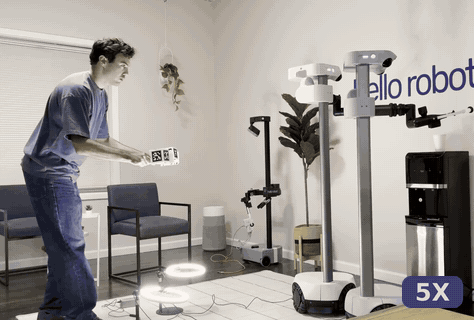
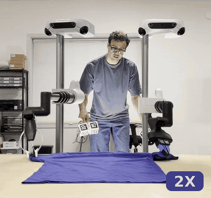
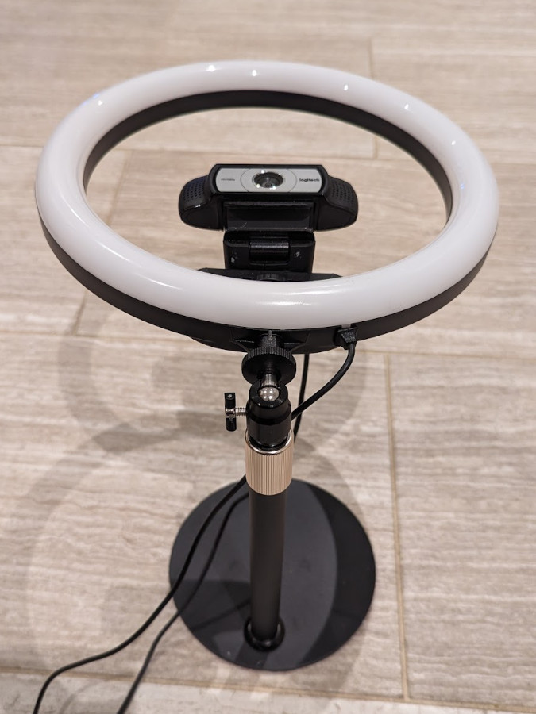
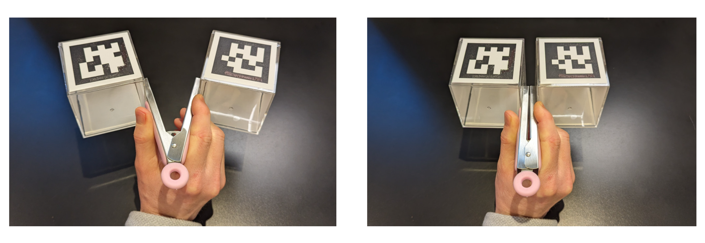
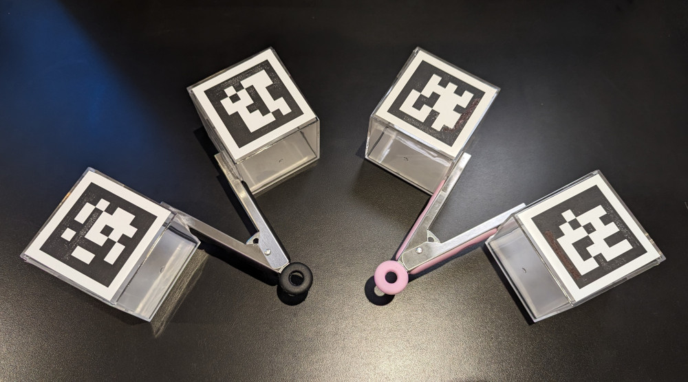

# Stretch 4 Dex Teleop 

<table>
  <tr>
    <td align="center"><b>Single Robot Teleoperation</b></td>
    <td align="center"><b>Bimanual Teleoperation</b></td>
  </tr>
  <tr>
    <td align="center"></td>
    <td align="center"></td>
  </tr>
</table>

This repository provides code for dexterous teleoperation of the [Stretch 4](https://hello-robot.com/stretch-4/) mobile manipulator from [Hello Robot](https://hello-robot.com/).

Dex Teleop supports bimanual dexterous teleoperation with Stretch mobile manipulators. As shown in the GIFs above, you can use it to perform efficient multijoint movement with one or two Stretch robots. 

The human operator uses modified kitchen tongs with attached ArUco markers to control the pose of the robot's end effector. A webcam looking up from a stand placed on the ground observes the tongs to estimate the tongs' position, orientation, and grip width. A ring light around the webcam ensures that the ArUco markers can be detected during fast motions by reducing motion blur. 

The system could be adapted to use other interfaces that can provide a six degree of freedom (6 DOF) target pose and grip width at a high rate (e.g., >= 15 Hz). The position of this target pose controls the end of the robot's telescoping arm via inverse kinematics (IK). The orientation of the target pose directly controls the robot's dexterous wrist joints and thereby controls the orientation of the robot's end effector. The grip width commands the robot's gripper.

## Motivation 

<div align="center">
  
</div>

Hello Robot provided code to teleoperate the first version of Stretch (the Stretch RE1) using a gamepad and a web interface. Both types of teleoperation have improved over the years with work from the Stretch community and Hello Robot. Gamepad teleoperation is simple and portable. Web-based teleoperation can be used over great distances and has been made accessible for people with disabilities. A notable disadvantage of these approaches is that they tend to favor slow single joint motions with a single arm.

## Setting Up Dex Teleop 

Start by cloning this repository onto the robot's computer:

```
cd ~/repos
git clone https://github.com/hello-robot/stretch4_dex_teleop.git
cd stretch4_dex_teleop
```

All of the commands below are run from the root of that directory.

### Buy or Build Your Interface

**A kit with tongs, a camera, a ring light, and a stand will soon be available from Hello Robot Inc.**

In the meantime, you can buy the components and build your own by following the **[Stretch Dex Teleop Hardware Guide](https://docs.google.com/document/d/1Pom3P8vVNRhchLK_CTduoqQJ3y_TS0MYIIAxRl94ktU/edit?usp=sharing)**.

You will need a camera, a ring light, and a stand as shown in the following photo. 

<div align="center">
  
</div>

For a single robot, you will need right-hand tongs like those shown in the following two photos.

<div align="center">
  
</div>

For bimanual manipulation, you will need two camera, two ring lights, two stands, left-hand tongs and right-hand tongs.

<div align="center">
  
</div>


### Install Interface Camera

Run the following script from the repository's root directory. It sets up the camera only -
the Python packages are installed in the next section.

```
./setup_camera.sh
```

The installation script sets up a udev rule for a Logitech Webcam C930e, so that the camera can be reset each time you run dexterous teleoperation. This is a workaround to avoid low frame rates and errors in the camera settings.


### Install Python Packages

First, create a Python virtual environment in the repository:


```
cd ~/repos/stretch4_dex_teleop
sudo apt install python3-venv
python3 -m venv .venv
source .venv/bin/activate
```

Now install the required Python packages in the virtual environment you created.

```
pip3 install --upgrade pip
python3 -m pip --version
pip3 install -r requirements.txt
```

**Every command from here on runs inside this virtual environment**, including the URDF
generation in the next section. Your prompt should start with `(.venv)`; if it doesn't, run
`source .venv/bin/activate` again. You can confirm with `which python3`, which should print a
path inside `.venv`.

Installing any of these outside the environment puts them in the robot's `~/.local` instead,
where Dex Teleop cannot see them — a virtual environment ignores user site-packages.


### Generate Specialized URDFs

To run Dex Teleop, you need to generate specialized URDF files. Dex Teleop uses forward
kinematic (FK) and inverse kinematic (IK) models of the robot. These models use specialized
URDFs built from your robot's own calibrated parameters.

```
python3 generate_ik_urdfs.py
```

This writes two files into the repository root, which is where `simple_ik.py` and
`gripper_to_goal.py` load them from:

```
stretch4_dex_teleop_base_rotation_ik_with_fixed_wrist.urdf
stretch4_dex_teleop_base_translation_ik_with_fixed_wrist.urdf
```

The URDFs are specific to the robot that generated them, so regenerate them rather than
copying them between robots. Regenerate them as well after the robot is recalibrated.

The script prints the file it wrote and sanity checks the merged arm joint's limit before
finishing. If it reports a problem instead, stop: an implausible arm limit means the IK would
accept wrist positions well beyond the robot's reach.

### Set Up the Camera, Ring Light and Stand

As shown in the photo above, the camera stand should be placed on the ground, and the camera should be pointed straight up. The stand should be at its minimum height. 

The camera should be plugged into the robot's trunk using a USB extension cable. The ring light should not be plugged into the robot's trunk as it requires too much power - it can either be plugged into the robot's head, or externally.

When using the camera, the top of the camera should be pointed away from you. With respect to the robot, the top of the camera points in the direction of arm extension, the lens of the camera looks in the direction of the lift moving up, and the left of the camera points in the direction of the robot's mobile base moving forward. 

### Calibrate the Logitech C930e Webcam

After setting up your camera, you need to calibrate it. 


First, generate a calibration board using the following command: 

```
python3 webcam_calibration_create_board.py
```

This should result in the following PNG file. 

```
webcam_aruco_calibration_board.png
```

Print this image out without scaling it. The resulting printout should match the dimensions specified in the PNG file. 

Mount the resulting printout on a flat surface that you can move around the camera to capture calibration images **with the ring light turned on**. 

Use the following command and your calibration pattern to collect calibration images for your Logitech C930e webcam. The entire calibration board should be visible and not too far away, or else the calibration images can lead to errors.

```
python3 webcam_calibration_collect_images.py
```

The images will be stored in the following directory. 

```
./webcam_calibration_images/Logitech Webcam C930e/1920x1080
```

Once you've collected the calibration images, run the following command to process the images. 

```
python3 webcam_calibration_process_images.py
```

Processing the images will generate a YAML calibration file similar to the following file.

```
./webcam_calibration_images/Logitech Webcam C930e/1920x1080/camera_calibration_results_20231211211703.yaml
```

### Test the Camera

To make sure that your camera detects the ArUco markers on your tongs, **turn on the ring light** and run the following code.

```
python3 webcam_teleop_interface.py
```

You should see images from the camera with green boxes drawn around detected ArUco markers. 

## Running Dex Teleop

After you've gotten everything setup, you can try out Dex Teleop. Make sure to start with slow motions, to test your system, gain experience, and warm up. 

Dex Teleop runs from the same virtual environment it was installed into, so activate it first
in each new terminal:

```
cd ~/repos/stretch4_dex_teleop
source .venv/bin/activate
```

### Start with Slow Motions!

After setting everything up, run the following command without any command line arguments. **This will result in the robot moving at the slowest available speed while you ensure that everything is working properly and get used to using the teleoperation system.**

```
python3 dex_teleop.py
```


### Command Line Options

```
python3 dex_teleop.py --help
```

| Option | Effect |
| --- | --- |
| `-f`, `--fast` | Move at the robot's `fast` motion profile instead of `slow`. |
| `-g`, `--ground` | Work at ground level instead of the default tabletop to countertop range. |
| `-i`, `--slide_lift_range` | Let the lift's range of motion slide up and down as you hold the tongs high or low. |
| `-l`, `--left` | Use left-hand tongs, for the left robot of a bimanual pair. |
| `-m`, `--multiprocessing` | Split the interface and robot control into two processes. See below. |
| `--no-gui` | Do not open the camera window. Use this headless, or over SSH without X forwarding. |

**Working height.** The tongs give 50 cm of vertical travel, and that maps onto 50 cm of the
lift's 120 cm of travel. By default those 50 cm sit at the top, so the lift spans **0.70 m to
1.20 m** - tabletop to countertop. With `--ground` they sit at the bottom instead, **0.00 m to
0.50 m**, for working on the floor.

**Sliding the range.** `--slide_lift_range` removes that fixed window: hold the tongs near the
top of their travel and the lift's range gradually slides upward, hold them near the bottom and
it slides down. This reaches the whole lift without restarting, at the cost of a less direct
relationship between where the tongs are and where the gripper is.

**Speed.** `--fast` raises the base, lift, arm and wrist speeds - the arm goes from 0.10 to
0.60 m/s. Start without it until you are comfortable with the system. If the arm stalls or
moves jerkily in this mode, see [Troubleshooting](#troubleshooting).


### Advanced: Multiprocessing with Shared Memory

To achieve better performance, you can run Dex Teleop using two processes that communicate via shared memory.

First, run the interface process in a terminal. This process observes ArUco markers with the webcam to create goals for the robot's gripper.

```
python3 goal_from_teleop.py --multiprocessing
```

Second, run the robot process in a different terminal. This process receives gripper goals and attempts to achieve them by controlling the robot. 

```
python3 gripper_to_goal.py --multiprocessing 
```

### Advanced: Bimanual Dex Teleop

To perform bimanual teleoperation, you can follow the instructions above on a second robot and use the "--left" command line argument. When run with "--left", the code will only respond to left-hand tongs, which have ArUco markers with ID numbers that are different from the right-hand tongs. 

This is two independent instances rather than a coordinated mode: each robot runs its own copy
of Dex Teleop, with its own webcam and its own set of tongs, and neither knows about the other.
`--left` only changes which marker IDs are looked up, so the two sets of tongs must be built
with different markers.

Set the second robot up exactly like the first. The camera calibration, the udev rule and the
Python install are all per-robot steps, and the specialized URDFs must be generated on each
robot rather than copied between them.

For example, for the left-hand robot, you can run the following command to try slow motion Dex Teleop.

```
python3 dex_teleop.py --left
```

## Troubleshooting

If you're having trouble with the steps in the guide, please check the following tips:

### Arm stops abruptly or moves jerkily during Fast Mode

Fast mode (`--fast`) selects the robot's factory `fast` motion profile: lift 0.40 m/s and arm
0.60 m/s, between `default` and `max`. It asks the arm and lift motors to apply higher effort
to track (and apply contact according to) the reference trajectory. If you're seeing abrupt or
jerky motions, try the following tips:

 - The percentage effort the motor needs varies with the robot's system voltage, so run fast
   mode with the robot well charged - on the dock, or with the official 36V charger connected.
   See the [Stretch 4 Hardware Guide](https://docs.hello-robot.com/stretch4_docs/guides/hardware-guide)
   for charging and the docking station.
 - If the robot is already well charged, the motors' effort threshold may need to be calibrated. On Stretch 4 the tool is `REx_stepper_contact_calibration`, run once per joint as `REx_stepper_contact_calibration --arm` and `REx_stepper_contact_calibration --lift`. The [Practical guide to guarded contacts](https://forum.hello-robot.com/t/practical-guide-to-guarded-contacts/654) post covers the idea, though it names the older `REx_calibrate_guarded_contact.py` CLI.


## Acknowledgment

Blaine Matulevich has been extremely helpful throughout the development of Dex Teleop, including testing, providing feedback, discussing the system, and contributing ideas. The entire Hello Robot team provided essential support throughout, including helping with early versions of Stretch 3, which the entire company worked on intensely.
